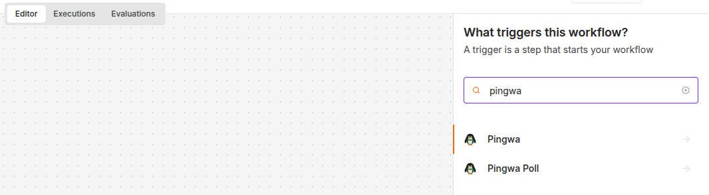
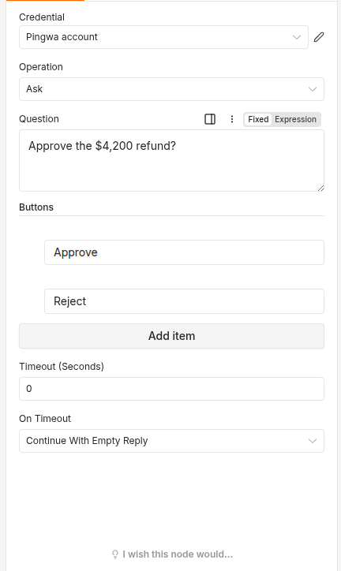
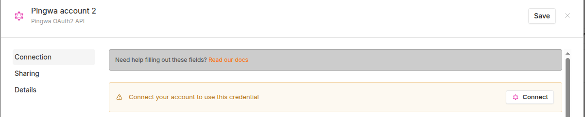
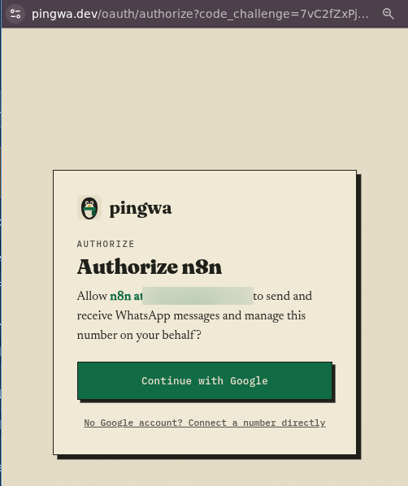
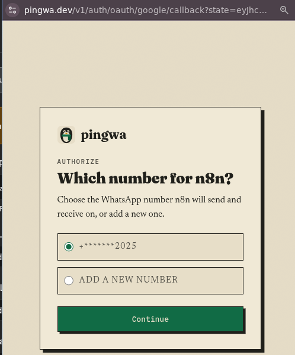
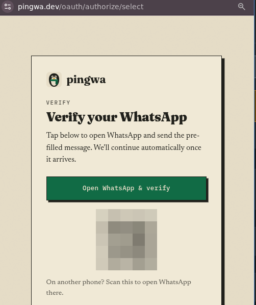

# n8n-nodes-pingwa

This is an n8n community node. It lets you use **[pingwa](https://pingwa.dev)** in
your n8n workflows.

pingwa is a hosted service that sends WhatsApp messages to **your own** phone and
reads your replies back. Your workflow notifies you, asks you to approve or reject
a step, and continues once you answer. It uses a WhatsApp number that pingwa hosts,
so you do not need a Meta Business account, your own phone number, or an API
review to get started.

[Installation](#installation) ·
[Operations](#operations) ·
[Credentials](#credentials) ·
[How this differs from the built-in WhatsApp node](#how-this-differs-from-the-built-in-whatsapp-node) ·
[Compatibility](#compatibility) ·
[Usage](#usage) ·
[Resources](#resources) ·
[Version history](#version-history)

## Installation

Follow the [community nodes installation
guide](https://docs.n8n.io/integrations/community-nodes/installation/). In n8n go
to **Settings → Community Nodes → Install** and enter:

```
n8n-nodes-pingwa
```

The `Pingwa` and `Pingwa Trigger` nodes then appear in the node panel.



## Operations

### Pingwa: Notify

Send a message. No reply expected.

- **Message**: the text to send, for example `Backup finished: 42 GB in 6 minutes.`
- **Send To**: who gets it. See [Send To and acknowledgement](#send-to-and-acknowledgement).
- **Ask for Acknowledgement**: optional. Adds an "On it" button. See below.
- **Image URL**: optional. Must be a public `https` URL.
- **Idempotency Key**: optional. Resending with the same key does not send twice.

Output: `{ id, billing_class, status }`

### Pingwa: Ask

Send a question and hold the workflow until you answer, or until it times out.

- **Question**: for example `Approve the $4,200 refund?`
- **Send To**: who gets the question. See [Send To and acknowledgement](#send-to-and-acknowledgement).
- **Buttons**: quick-reply titles, for example `Approve`, `Reject`
- **Timeout (Seconds)**: `0` uses the server default, or set your own
- **On Timeout**: continue with an empty reply, or fail the node

Output: `{ message_id, billing_class, answered, reply }`. On timeout with
"Continue" selected: `{ answered: false, timedOut: true, message_id }`.



### Pingwa: Get Reply

Fetch the reply to a message you sent earlier, with Ask or Notify, without holding
an execution open.

- **Message ID**: the `id` from an earlier Notify or Ask
- **Wait (Seconds)**: wait up to this many seconds for a reply. `0` returns at once.

Output: `{ message_id, answered, reply }`

### Send To and acknowledgement

**Send To** is on Notify and Ask. It has three choices:

- **Me** (default): your own linked WhatsApp number. The node leaves `to` out of the
  request, so workflows built before 0.1.7 send exactly what they sent before.
- **Team**: you and every active member of your pingwa team (`to: "team"`).
- **Specific Members**: a comma-separated list of member IDs or names, for example
  `Ana, Bob`. `me` in the list means you. An empty list fails the node, so a typo
  never falls back to sending to yourself.

Each person who receives it counts against your quota. If your plan or the team
setup does not allow the send, pingwa answers with an error and the node shows it.

**Ask for Acknowledgement** is on Notify only. Switch it on to add an **On it**
button to the message. The first tap is the answer, which you can read with
**Get Reply**, and the others on the team are told who took it. It needs a plan that
includes acknowledgement, and it cannot be combined with **Image URL**. It is off by
default, and the node then leaves `ack` out of the request. Ask has no
acknowledgement option, because you already choose its answer buttons.

### Pingwa Trigger

Starts a workflow when a WhatsApp message comes in. The **Delivery** option says how the
message reaches n8n. Pick the one that matches how your n8n is reachable.

- **Webhook** (default): use this if n8n has a public `https` URL. pingwa registers a
  webhook when you activate the workflow and removes it when you deactivate. It
  pushes each message the moment it arrives. It emits `{ event, message_id, body,
  button_id, reply_to_message_id, wa_message_id, window_open, created_at, media? }`.
- **Polling**: use this if n8n is local, LAN-only, or behind a firewall. It pulls
  `/v1/inbox` on the schedule you set in **Poll Times**, and registers nothing on the
  pingwa side. It emits the same fields except `window_open` and `media`, because
  `/v1/inbox` does not return them. Inbound images and voice notes arrive only
  through the webhook.

**Poll Times** is n8n's own field for polling nodes. It is ignored in Webhook mode.

The **Events** option works in both modes: All Inbound Messages or Replies Only.

## Credentials

pingwa offers two credentials. Pick one.

### Pingwa OAuth2 API (one click)

1. Add a **Pingwa OAuth2 API** credential and click **Connect**. There is nothing
   to fill in. The defaults target `pingwa.dev`.

   

2. A pingwa tab opens. **Continue with Google**, or connect a number directly.

   

3. Choose which WhatsApp number n8n sends and receives on, or add a new one.

   

4. For a new number only: tap **Open WhatsApp & verify** and send the pre-filled
   message, or scan the QR code from another phone. pingwa spots it and continues
   on its own. There is no code to type.

   

5. The tab closes and n8n stores the token.

If you pick a number that is already verified, you skip step 4.

### Pingwa API (paste a key)

1. Open WhatsApp and send `join` to the pingwa number.
2. pingwa replies with your key (`pw_...`).
3. Add a **Pingwa API** credential and paste it.

n8n's **Test** button checks the key against `GET /v1/me`, so a green tick means
the key works before you build anything.

> Leave **Base URL** at its default (`https://pingwa.dev`). Change it only if you
> run a self-hosted or staging pingwa.

## How this differs from the built-in WhatsApp node

n8n ships a built-in **WhatsApp Business Cloud** node. It and pingwa solve
different problems, and they work well side by side.

| | Built-in WhatsApp node | pingwa |
|---|---|---|
| Number | **Your own** WhatsApp Business number | A number **pingwa hosts** |
| Setup | Meta Business verification, phone number, app | Send `join` once, or click Connect |
| Who you message | Any customer who opted in | **Your own linked WhatsApp**, or members of your own pingwa team |
| Best for | Customer messaging at scale | Notifying **yourself** and approvals |

Use the built-in node to message customers from your own WhatsApp Business
account. Use pingwa when you want a workflow to ping **you** or your team. There is
no Meta setup, and you can message only yourself and members who joined your pingwa
team, so there is no outreach or spam surface.

## Compatibility

Built and tested against n8n node API version 1. Needs **n8n 1.83 or later** —
that is the first release whose `n8n-workflow` exports `NodeConnectionTypes`, which
the node uses. Requires Node.js 20.15 or later, which matches n8n's own runtime.

## Usage

- Notify and Ask are the two you reach for first. Use Notify for a one-way ping.
  Use Ask when the workflow must wait for your decision.
- Every operation supports **Continue On Fail**. Turn it on and a failed item
  emits `{ error }` instead of stopping the workflow.
- New to community nodes? See [Try it
  out](https://docs.n8n.io/try-it-out/) in the n8n docs.

## Resources

- [n8n community nodes documentation](https://docs.n8n.io/integrations/community-nodes/)
- [pingwa API documentation](https://pingwa.dev/docs)

## Version history

- **0.1.7**: New **Send To** option on Notify and Ask (Me, Team, or specific members)
  and new **Ask for Acknowledgement** option on Notify. Both are off by default and
  leave the request unchanged, so existing workflows behave as before.
- **0.1.6**: **Breaking.** The two triggers are now one node. `Pingwa Poll Trigger`
  is gone; use `Pingwa Trigger` with **Delivery** set to `Polling` instead. A workflow
  built on the old poll trigger keeps its settings but needs the node swapped.
  Webhook teardown failures are now logged instead of dropped.
- **0.1.5**: Passes the n8n verification ruleset — credential icons, typed
  connection types, wrapped API errors. Needs n8n 1.83 or later.
- **0.1.4**: Plainer wording in the README and node fields.
- **0.1.3**: README and node-panel polish (light and dark icon, labelled
  subtitles, field placeholders). Usable as an AI Agent tool. Published with npm
  provenance.
- **0.1.0**: first release. Notify, Ask, and Get Reply, webhook and poll triggers,
  API-key and OAuth2 credentials.

## License

MIT
